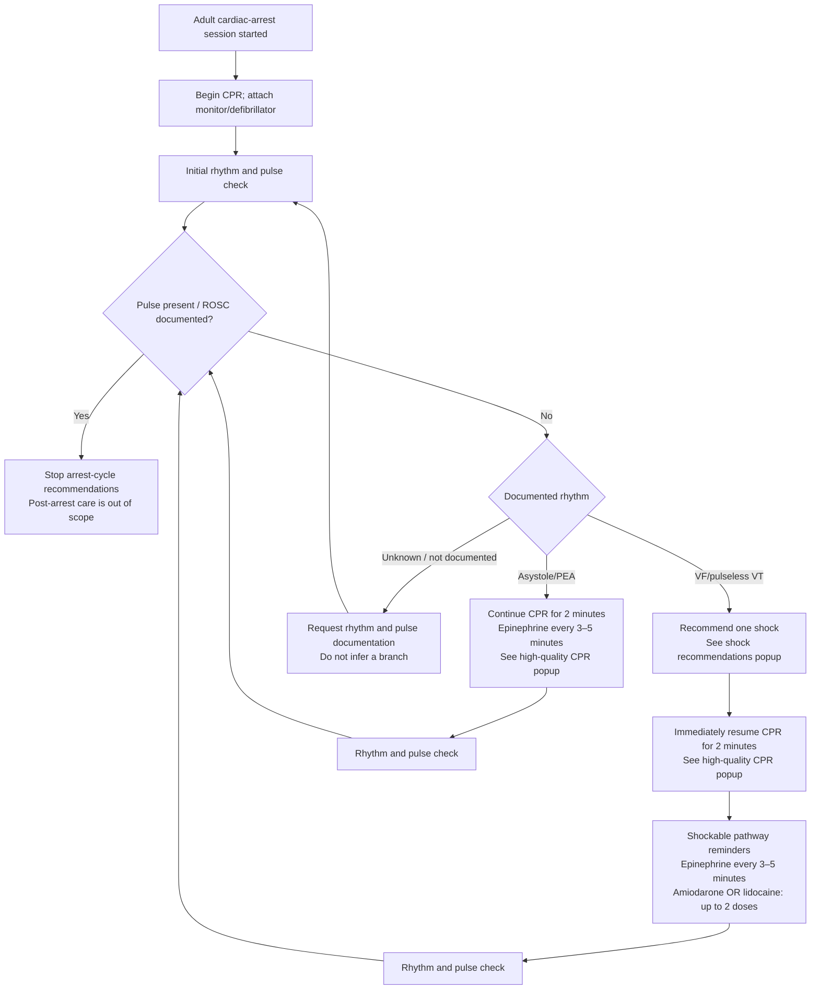

# Adult ACLS Cardiac Arrest — Decision Tree Draft

> **Clinician-approved for synthetic simulation implementation only — not approved for live clinical use.** This document defines the adult cardiac-arrest pathway implemented by the deterministic rules engine. Other ACLS/PALS pathways remain disabled.

**Source baseline:** 2025 AHA Adult Cardiac Arrest Algorithm  
**Reviewer:** Project clinician reviewer  
**Status:** Flow approved for implementation by the project clinician reviewer

## Decision tree

Popup guidance: [High-quality CPR](#high-quality-cpr-popup) · [Shock recommendations](#shock-recommendations-popup)

### Pathway notes

- Rhythm and pulse are separately documented inputs. The app must not infer PEA from an organized rhythm without a documented absent pulse.
- A due cycle prompts a check; it does not record a pause, rhythm, pulse, shock, or medication.
- Medication reminders use actual documented administration times. A reminder never records that a medication was given.
- “Up to 2 doses” applies to the selected antiarrhythmic (amiodarone **or** lidocaine); confirm the precise source wording and administration sequence during review.
- A documented pulse/ROSC leaves this arrest loop. Post-arrest care is not covered in this draft.
- An unknown rhythm or pulse does not select a branch. Preserve manual documentation and display what is missing.

## Guidance popups

These are the proposed contents of the contextual help popups linked from the decision tree. Please confirm the wording and details against the linked 2025 AHA PDF.

### High-quality CPR popup

[Open the AHA 2025 Adult Cardiac Arrest Algorithm PDF](https://cpr.heart.org/-/media/CPR-Files/CPR-Guidelines-Files/2025-Algorithms/Algorithm-ACLS-CA-250527.pdf?sc_lang=en)

- Push hard: at least 2 inches (5 cm).
- Push fast: 100–120 compressions per minute.
- Allow complete chest recoil.
- Minimize interruptions in compressions.
- Avoid excessive ventilation.
- Change compressors about every 2 minutes, or sooner if fatigued.
- Without an advanced airway: use a 30:2 compression-to-ventilation ratio.
- With an advanced airway: continuous compressions and 1 breath every 6 seconds.
- Use continuous waveform capnography when available; if ETCO₂ is low or decreasing, reassess CPR quality.

### Shock recommendations popup

[Open the AHA 2025 Adult Cardiac Arrest Algorithm PDF](https://cpr.heart.org/-/media/CPR-Files/CPR-Guidelines-Files/2025-Algorithms/Algorithm-ACLS-CA-250527.pdf?sc_lang=en)

- For a shockable rhythm (VF/pulseless VT), recommend a single shock, then immediately resume CPR for 2 minutes before the next rhythm check; do not recommend stacked shocks.
- **Biphasic:** use the manufacturer's recommended energy (commonly 120–200 J); if the device recommendation is unknown, use the maximum available setting. Subsequent shocks may use an equivalent or higher energy according to device guidance.
- **Monophasic:** 360 J.
- The popup is informational. The app does not select device settings or deliver a shock; the clinician determines and documents the action.

## Approval record

**Clinician disposition:** Flow approved for deterministic implementation in synthetic simulations  
**Review date:** 2026-10-08  
**Limit:** This approval is not clinical validation for live-patient use.
